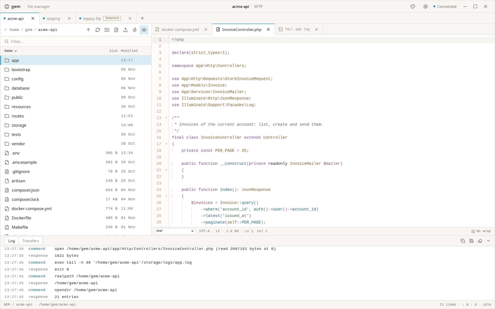

<p align="center">
  
</p>

<h1 align="center">Gem</h1>

<p align="center">
  <a href="https://github.com/mnml-tools/gem/actions/workflows/rust.yml"></a>
  <a href="https://github.com/mnml-tools/gem/actions/workflows/desktop.yml"></a>
</p>

<p align="center">
  A minimal remote file manager for SFTP, FTP and FTPS.
</p>

Gem browses your servers in tabs and shows any remote file right away, with syntax highlighting
and indentation, **without downloading it**. Fix something, press Ctrl+S, and it is saved back
safely. The connection log stays quietly at the bottom. It's built with Tauri, React,
TypeScript, and Rust.

<picture>
  <source media="(prefers-color-scheme: dark)" srcset="docs/gem-screenshot-dark.png">
  <source media="(prefers-color-scheme: light)" srcset="docs/gem-screenshot-light.png">
  
</picture>

View screenshots in [light mode](docs/gem-screenshot-light.png) or [dark mode](docs/gem-screenshot-dark.png).

> [!NOTE]
> Gem is pre-release (0.1). It is tested on Linux with KDE Plasma, by hand and with native
> end-to-end scenarios against real servers. Windows and macOS build in CI but have not been
> tested by hand yet. See [Platform support](#platform-support).

## What you can do

- **Connect** over SFTP (password, key file, SSH agent), FTP or FTPS (explicit or implicit), in
  as many tabs as you like, also several to the same server. Save sites, or use quick connect
  (`sftp://user@host:22/var/www`). Passwords and key passphrases are kept only in your system's
  keyring.
- **Trust servers knowingly.** The first connection shows the server's SHA-256 fingerprint; a
  changed SSH host key or certificate blocks the connection. Plain FTP is marked _Insecure_.
- **Browse** remote folders: breadcrumbs, sort, filter, hidden files, symlinks, rename, new
  folder or file, delete (folders too, with a report), permissions. Huge folders stay fluid.
- **View without downloading.** Space previews a file, Enter keeps it open in a tab. PHP, Go,
  YAML, JSON, JavaScript/TypeScript, HTML, CSS, XML, SQL, Python, Rust, shell, Markdown,
  `.env`/INI, TOML, nginx, Apache, Dockerfile, Makefile and logs are highlighted, with
  indentation guides, folding and search. Files are read into memory only; big logs load in
  windows.
- **Edit and save back.** Gem checks that nobody changed the file on the server since you opened
  it, writes a temporary copy next to it and swaps it in with the same permissions, and keeps the
  encoding, line endings and final newline exactly as they were.
- **Transfer** files and folders: drag them from your file manager onto Gem, or download to your
  Downloads folder. A queue at the bottom shows progress, with cancel, retry and Overwrite / Skip /
  Rename for existing files.
- **Run your usual commands** on SSH servers: `crontab -l`, `docker logs core | tail -30`, or
  anything else, from saved snippets (global or per site, with `{dir}` for the current folder and
  an optional confirmation) or typed in the Ctrl+K palette. The output opens in a tab next to your
  files, with errors marked, the exit status, search, Re-run and Stop. No terminal: interactive
  programs like `vim` or `htop` are not supported.
- **Read the connection log**: every command and reply, errors in red, passwords always masked.
  Copy it or save it.
- **Make it yours** with light or dark mode and five accent colours, shared with the other
  mnml-tools apps.

## Run locally

Install Node.js 22 or later, pnpm 11 (`corepack enable`), Rust 1.90 or later, and the
[Tauri prerequisites](https://v2.tauri.app/start/prerequisites/) for your operating system. On
Debian or Ubuntu:

```sh
sudo apt install libwebkit2gtk-4.1-dev librsvg2-dev libxdo-dev libssl-dev
```

From the project root, run:

```sh
pnpm install
pnpm tauri dev
```

Set `GEM_DATA_DIR=/some/folder` to keep your real sites out of reach while you test.

To try Gem against real servers without touching yours, start the local test servers (Docker,
bound to `127.0.0.1` only, test-only credentials) described in
[dev/servers/README.md](dev/servers/README.md):

```sh
pnpm servers:up
```

Use `pnpm dev` to preview the interface in a browser at <http://localhost:1426>. Outside Tauri,
an in-memory mock with demo sites and a fake remote tree answers every command; it is dev-only
and resets on reload. Its switches are listed in the
[design system notes](docs/ui-design-system.md#7-browser-preview).

## Build desktop packages

Every build regenerates the third-party licence notices and ships them inside the package.
Packages land in `src-tauri/target/release/bundle/` (or under the target triple for macOS).

### Linux

```sh
pnpm install
pnpm tauri build --bundles deb,rpm,appimage
```

Packages are not signed; publish checksums with them.

### macOS

On a Mac with Xcode 26 or newer selected with `xcode-select`, run:

```sh
rustup target add aarch64-apple-darwin x86_64-apple-darwin
pnpm install
pnpm tauri build --target universal-apple-darwin --bundles app,dmg
```

The app is not Developer ID signed or notarised, so Gatekeeper blocks it on first open:
right-click › Open, or run `xattr -dr com.apple.quarantine Gem.app`. For public distribution, see
[Tauri's macOS signing guide](https://v2.tauri.app/distribute/sign/macos/).

### Windows

```sh
pnpm install
pnpm tauri build --bundles nsis,msi
```

The installers are not signed, so SmartScreen warns on first run (More info › Run anyway).

## App icons

Edit `src-tauri/icons/AppIcon.icon` in Icon Composer, then run `pnpm icons` on macOS with
Xcode 26 or newer selected. This exports a temporary PNG, builds `icon.icns` from it, and
compiles the native macOS icon catalog. The temporary PNG is removed afterward. Linux, Windows
and Android use the flat tile in `src/assets/AppIcon.png` instead, like the other co-op apps.

Run `pnpm icons:mac` to compile only the native macOS icon catalog, or `pnpm icons:png` to
regenerate the flat assets from `src/assets/AppIcon.png` on any platform (`icon.icns` and the
iOS icons are left alone). macOS builds automatically
compile and bundle the native catalog while retaining the ICNS fallback for older macOS versions.
Desktop CI runs `pnpm icons` on macOS and `pnpm icons:png` on Linux and Windows.

## Automated desktop builds

The **Desktop builds** GitHub Actions workflow runs on every push to `main`, on version tags
matching `v[0-9]*`, and through **Run workflow** in the Actions tab. It runs the frontend and Rust
checks, then builds Linux `.deb`, `.rpm` and AppImage packages, a universal macOS `.app` and
`.dmg`, and Windows NSIS and MSI installers. Download them from the run's **Artifacts** (named
`Gem-<platform>-<commit>`, kept 14 days).

To publish a release, update the version in `package.json`, `src-tauri/Cargo.toml`,
`src-tauri/Cargo.lock` and `src-tauri/tauri.conf.json`, commit, and push a matching tag
(`git tag v0.1.0 && git push origin v0.1.0`). The release gets every package and a
`SHA256SUMS.txt`, and a `latest.json` for the in-app updater (ADR 0015).

Tag builds sign the updater packages, so the repository needs three Actions secrets first:
`TAURI_UPDATER_PUBLIC_KEY`, `TAURI_SIGNING_PRIVATE_KEY` and `TAURI_SIGNING_PRIVATE_KEY_PASSWORD`.
Create the key pair once with `pnpm tauri signer generate -w ~/.tauri/gem.key` and keep the
private key safe: installed copies only accept updates signed with it. Tags with a suffix
(`v0.2.0-beta.1`) are published as prereleases, which the updater ignores.

## Development checks

```sh
pnpm verify
```

This is what CI runs: `pnpm typecheck`, `pnpm lint` (ESLint and Prettier), `pnpm test` (Vitest),
`pnpm rust:fmt`, `pnpm rust:lint` (Clippy with `-D warnings`), `pnpm rust:test` and `pnpm build`.
Run `pnpm bindings` after changing a Rust DTO; CI fails if `src/lib/ipc/bindings` is stale.

The protocol and service integration suites run against the Docker test servers (CI runs them
too):

```sh
pnpm servers:up
pnpm rust:it
pnpm servers:down
```

Native end-to-end scenarios run the release build in a private virtual KWin session against the
same servers, so the production CSP and permissions are in force; see [docs/e2e.md](docs/e2e.md):

```sh
pnpm tauri build --no-bundle
sh scripts/e2e/all.sh
```

`scripts/e2e/presentation.sh` produces the screenshots above (`THEME=light|dark`, at 2x).

The code layout and the security boundaries are described in the
[architecture guide](docs/architecture.md); decisions are recorded in [docs/adr](docs/adr).

## Platform support

- **Verified on Linux** with KDE Plasma 6.7 (Wayland, the app through XWayland in the E2E
  session): connecting, trusting, browsing, viewing, editing, conflicts, big files, several tabs,
  downloads and dropped connections, with the native E2E scenarios. Uploads by drag and drop and
  the native file dialogs still need a check by hand.
- **Protocols** are verified against OpenSSH 10, vsftpd 3.0.5 and ProFTPD 1.3.9 in Docker. Other
  servers will have their own quirks; reports with the connection log (hostnames masked) are very
  welcome.
- **Windows and macOS** build and pass the Rust tests in CI, but have not been run by hand. The
  SSH agent on Windows (Pageant / OpenSSH named pipe) is untested; key files and passwords do
  not depend on it.
- **Keyring:** without a system keyring (Secret Service on Linux), Gem cannot remember passwords
  and asks for them when connecting. It never stores them in plain text.

## License

Gem is open source under the [MIT License](LICENSE). Third-party dependencies keep their own
licences; their notices are generated into
[src-tauri/resources/THIRD_PARTY_LICENSES.md](src-tauri/resources/THIRD_PARTY_LICENSES.md) by
`scripts/third-party-licenses.mjs` and shipped with every package. Report security issues
privately as described in [SECURITY.md](SECURITY.md).
